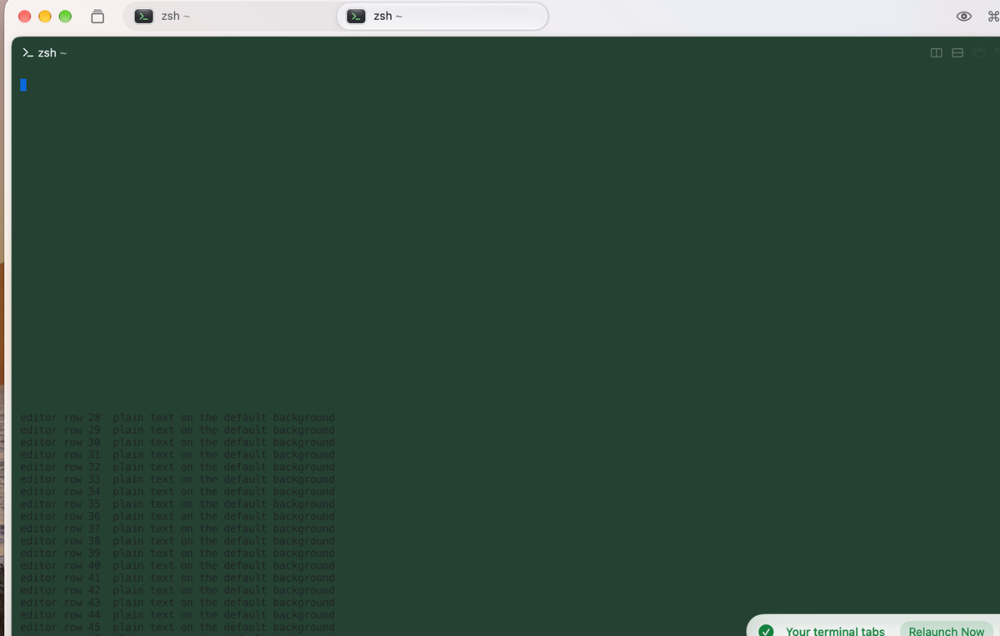
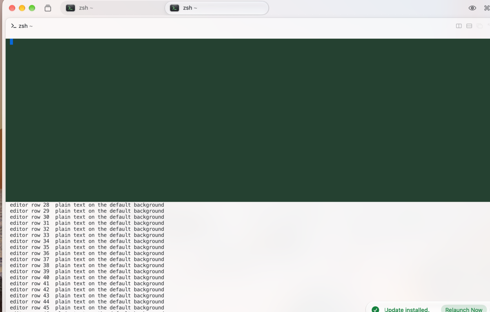
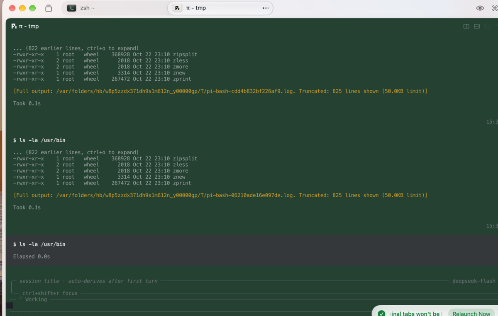

# Rex Beta loses the SGR reset at the right margin, so the next row inherits the previous background

Rex Beta (macOS) does not apply the `ESC[0m` that follows a write which reaches the
last column. The background of that row survives, and the next row's erase-in-line
(`ESC[2K`) uses it — because erase-in-line is background-colour-erase (BCE) and
takes the current background. The result: every row below a styled block is painted
with that block's colour.

This is a terminal-level bug. Any fullscreen TUI that pads its lines to the pane
width and appends a reset hits it. Pi's renderer does exactly that, which is how we
found it: the whole panel turns green, intermittently, after a tool result.

## Reproduce

Any Rex Beta pane; captured at 163×47 with the dark theme.

```sh
python3 repro.py          # rows below the block turn green
python3 repro.py short    # control: one column short of the margin, clean
```

Expected in both modes: the block is green, and every row below it stays on the
default background.

Actual in `flood`: every row below the block, down to the last row of the pane, is
green.

| `python3 repro.py` | `python3 repro.py short` |
|---|---|
|  |  |

The two modes write the same bytes except for one column of padding.

## Why

Each block row is written as:

```
ESC[<row>;1H  ESC[2K  ESC[48;2;37;65;49m  <cols spaces>  ESC[0m
```

- With `pad = cols`, the reset arrives when the cursor is parked at the right margin
  with autowrap disabled (`ESC[?7l`). Rex does not apply it, so the background stays
  green.
- The next row's `ESC[2K` erases with the current background, painting that row green,
  and so on for the rest of the frame.
- With `pad = cols - 1`, the reset arrives before the margin and is applied; the frame
  stays clean.

## Real-world case

`pi-tui`, the renderer behind Pi, pads every rendered line to the pane width and
appends the reset, so the reset always lands exactly at the margin. `screens/pi.png`
is a real Pi frame in Rex: the transcript is green because it is full of tool blocks,
but the editor and status bar below it are green too — rows Pi never colours. The
frame is intermittent: it depends on whether the frame's earlier rows leave the
background unreset when the erase happens.



## Workaround

Emit the reset before the erase instead of relying on the previous row's trailing
reset:

```
ESC[<row>;1H  ESC[0m  ESC[2K  <line>
```

Then no row can inherit a background the terminal failed to reset. This is the fix
being proposed to `pi-tui`; it costs four bytes per row and removes the dependency on
the terminal's margin behaviour.

## Who to talk to

Rex is built by [Superlogical](https://www.superlogical.com/): Mitchell Hashimoto
(creator of Ghostty, co-founder of HashiCorp), Jack Pearkes, Alasdair Monk and Hector
Simpson. Rex is in public beta and free; the docs are at
<https://www.superlogical.com/rex/docs/>.

## Environment

- Rex Beta (`com.superlogical.rex`) on macOS 27, dark theme, 163×47 pane.
- Reproducer is pure `python3` + ANSI: no Pi, no plugin, no Rex internals.
